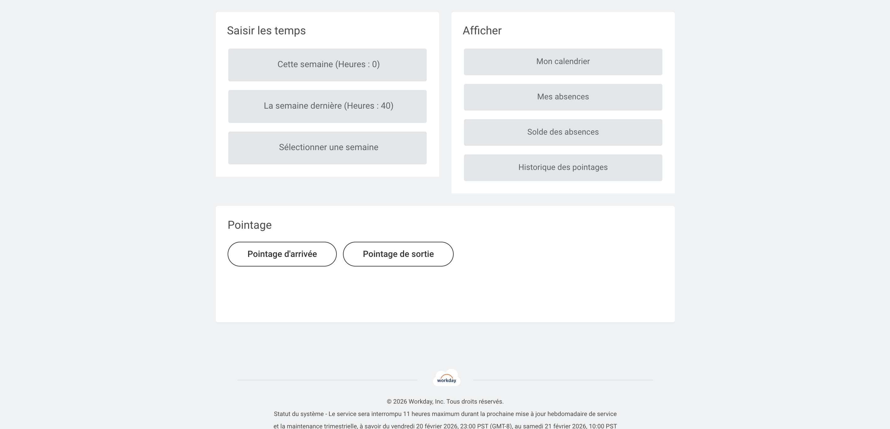

# Jira → Workday Time Tracking

CLI tool that automatically fills your Workday timesheet based on your Jira activity.

It fetches the Jira issues you worked on during a given week, groups them by top-level Initiative, and distributes your working hours proportionally — then fills in Workday for you via browser automation.

## How it works

1. Queries Jira for all issues **assigned to you** and **updated during the selected week** (excluding Epics)
2. For each issue, walks up the parent chain to find the top-level **Initiative**
3. Counts how many issues belong to each Initiative and computes a proportional hour split
4. Adds fixed time for **maintenance** and **administration** (configurable ratios)
5. Opens Chrome, navigates to Workday, and fills the timesheet rows automatically

The remaining hours (after maintenance + admin) are split across Initiatives proportionally to the number of issues you touched. Rounding leftovers are added to maintenance. Each day is filled with **8 hours**.

## Prerequisites

- **Node.js** (>= 18)
- **Google Chrome** installed at the default macOS path
- A **Jira API token** ([generate one here](https://id.atlassian.com/manage-profile/security/api-tokens))

## Setup

```bash
git clone <repo-url> && cd jira-timetracking
npm install
```

Create a `.env` file at the project root:

```env
JIRA_EMAIL="your-email@company.com"
JIRA_API_TOKEN="your-api-token"
JIRA_HOST="your-jira-host" # usually "https://your-company.atlassian.net"
WORKDAY_TIMETRACKING_URL="https://wd3.myworkday.com/…"
```

You can find the `WORKDAY_TIMETRACKING_URL` by going to the Workday timesheet page below and copying the URL from the address bar.



## Usage

```bash
npm run tracking
```

The interactive CLI will prompt you for:

1. **Maintenance ratio** (0–1, default `0.2`) — fraction of each day allocated to maintenance
2. **Administration ratio** (0–1, default `0.2`) — fraction of each day allocated to admin
3. **Week** — which week to fill (this week, last week, up to 6 weeks ago)

Once Jira data is fetched and hours are computed, Chrome opens and fills Workday automatically. You'll be asked to confirm submission at the end.

### CLI flags

Skip the prompts by passing options directly:

```bash
npm run tracking -- -m 0.2 -a 0.2 -w 1 -y
```

| Flag                              | Description                                                          |
| --------------------------------- | -------------------------------------------------------------------- |
| `-m, --maintenance-ratio <ratio>` | Maintenance ratio (0–1)                                              |
| `-a, --admin-ratio <ratio>`       | Administration ratio (0–1)                                           |
| `-w, --week <number>`             | Week to fill: `0` = this week, `1` = last week, …, `6` = 6 weeks ago |
| `-y, --yes`                       | Skip the final confirmation prompt                                   |

### Example

With `-m 0.2 -a 0.2` and 3 Jira issues mapped to 2 Initiatives (A: 2 issues, B: 1 issue):

| Category     | Hours/day |
| ------------ | --------- |
| Maintenance  | 1.60h     |
| Admin        | 1.60h     |
| Initiative A | 3.18h     |
| Initiative B | 1.59h     |
| **Total**    | **8.00h** |

## Notes

- The script uses the Jira issue's **`updated`** date (not `created` or `resolved`) to determine which week it belongs to.
- Issues without a parent Initiative are counted in the logs but do not receive allocated hours — their share goes to the other Initiatives.
- Chrome launches with a dedicated profile (`/tmp/chrome-workday-profile`) so it doesn't interfere with your regular browser sessions. You may need to **log into Workday** the first time — the script waits up to 2 minutes for the page to load.
- The Workday UI selectors assume a **French locale**.
